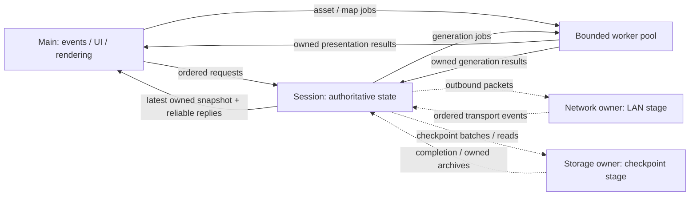

# Parallel SDL3 frontend architecture

This is the frontend architecture, researched on 2026-11-09. The local SDL
prototype has a session thread, bounded channels, worker-prepared native PNG
tilesets and map packets, and looping/on-demand animations. The bundled default is
Gen1 32x32 under `assets/tiles/gen1_32x32`. Expanded generation, network, and checkpoint
interfaces below remain proposals. Existing clients also
include FTXUI (`cataclysmx_game`) and scriptable/headless (`cataclysmx_headless`).

The first playable SDL client has independent rendering, authoritative session
execution, and background asset preparation. The process main thread owns SDL
events, UI, and rendering; a session thread owns gameplay. Later milestones
separate network transport and database execution once their current coupling
to the world has been removed. Frame rate never drives simulation time.

## Evidence and decisions

These precedents inform the design; the recommendations are our synthesis.
None establishes a measured speedup for this project.

| Case | Relevant evidence | Decision here |
| --- | --- | --- |
| OpenTTD | Its [video driver](https://github.com/OpenTTD/OpenTTD/blob/master/src/video/video_driver.cpp) separates game and drawing loops, with locks around shared game state. | Separate the loops, using owned snapshots so drawing needs no world lock. |
| Factorio | [FFF #70](https://www.factorio.com/blog/post/fff-70) describes overlapping update and rendering. [FFF #215](https://www.factorio.com/blog/post/fff-215) describes parallel sprite preparation and cache contention between apparently independent mutable systems. | Parallelize immutable preparation and explicitly separate ownership of mutable data. |
| Godot | Its [threading guidance](https://docs.godotengine.org/en/stable/tutorials/performance/thread_safe_apis.html) distinguishes resource preparation from access to active shared state and GPU resources. | Prepare privately, then hand results to the owning thread for activation. |
| Bright Nights | Its [tileset format](https://docs.cataclysmbn.org/mod/json/reference/graphics/tileset/) separates entity mappings from sprite sheets and pack metadata. | Resolve stable content names into compact sprite tables during loading; use a native format without promising Bright Nights compatibility. |
| Tiled | Its [animation frames](https://doc.mapeditor.org/en/stable/reference/json-map-format/#frame) reference local tiles and give each frame a duration in milliseconds. | Represent loops as explicit sprite references with individual integer millisecond durations. |
| Godot atlas animation | [TileSetAtlasSource](https://docs.godotengine.org/en/stable/classes/class_tilesetatlassource.html) exposes atlas regions, animation frames/durations, and synchronized or randomized starts. | Keep atlas regions separate from clips; start with synchronized phases and defer randomized starts. |
| SDL event waits | [SDL_WaitEventTimeout](https://wiki.libsdl.org/SDL3/SDL_WaitEventTimeout) waits for an event with a bounded timeout on the main thread. | Include the next visible animation boundary in the render deadline, so animation does not require input or a simulation update. |
| Dungeon Crawl Stone Soup | Its [tiles frontend](https://github.com/crawl/crawl/blob/master/crawl-ref/source/tilesdl.h) separates regions, layout, DPI, and redraw state; [tile buffers](https://github.com/crawl/crawl/blob/master/crawl-ref/source/tilebuf.h) collect drawing work. | Separate map presentation from screen layout and graphics submission. |
| Brogue CE | Its [platform interface](https://github.com/tmewett/BrogueCE/blob/master/src/platform/platform.h) provides an explicit input/display boundary. | Keep platform events and graphics resources outside simulation APIs. |

SDL3 requires [presentation](https://wiki.libsdl.org/SDL3/SDL_RenderPresent) and
[event polling](https://wiki.libsdl.org/SDL3/SDL_PollEvent) on its main thread.
Therefore the main thread is the dedicated platform/render owner, with gameplay
on another thread. SDL's 2D renderer is sufficient for the initial sprite map;
no graphics-backend change is needed to separate rendering from gameplay.

## Current integration points

| Existing boundary | SDL use |
| --- | --- |
| [Server](../src/core/server.h) | Submit typed commands, supply elapsed microseconds, consume `WorldView` and receipts on the session owner. |
| [World](../src/core/world.h) | Retain exclusive ownership of runtime entities on the session thread. |
| [Network adapter](../src/network/network.h) | Preserve hosting, admission, snapshots, discovery, reconnect, and sequence/opportunity checks. |
| [Content catalog](../src/content/content.h) | Resolve stable terrain/item names; keep the catalog immutable and alive until every reader stops. |
| [Input](../src/client/input.h) | Translate SDL events to `KeyChord`, then use `ResolveAction` in the active context. |
| [Settings](../src/client/settings.h) and [localization](../src/client/localization.h) | Reuse configuration, effective bindings, labels, outcomes, and item action text. |
| [Terminal application](../src/terminal/main.cpp) | Reference for lifecycle, command routing, receipts, and local/LAN modal behavior. |
| [Cell appearance](../src/client/text.cpp) | Preserve visibility filtering and overlay priority without coupling sprite rendering to FTXUI. |
| [World generation](../src/worldgen/worldgen.h) | Run pure region/chunk generation on immutable inputs; install results on the session owner. |

The existing APIs are synchronous and provide no concurrent access guarantee.
In particular, a `const` world inspection call is not permission to race with a
world mutation. Snapshot creation stays on the session owner.

## Execution and ownership

| Lane | Exclusive ownership and work | Introduction |
| --- | --- | --- |
| Main/render thread | SDL initialization/window/events, renderer, textures, renderer text engine, UI state, layout, drawing, presentation | First playable |
| Session thread | `Server`, `World`, simulation RNG, command admission/resolution, pacing, snapshot capture | First playable |
| Bounded worker pool | Asset reading/parsing/decoding, snapshot-based map preparation, deterministic region/chunk generation | Asset work first; presentation/generation next |
| Network thread | ENet hosts/peers, sockets, packet transmission, transport lifecycle events | LAN separation |
| Storage thread | SQLite connection, ordered checkpoint transactions and chunk reads | Checkpoint separation |



Rendering reuses the last completed snapshot or map packet while gameplay or
loading takes longer. The session never waits for a frame, present, or UI
callback. UI processing never waits synchronously for a session operation.

Use a small capped worker pool for independent coarse jobs. Give each job
immutable inputs and owned output storage; do not create a permanent thread per
screen, chunk, or item behavior. Start with explicit job kinds and dispatch,
RAII-managed threads, mutexes, and condition variables. Standard threading
facilities are appropriate where EASTL has no equivalent. A generic dependency
scheduler, lock-free queue library, and new allocator are unnecessary for this
design.

## Requests, replies, and snapshots

The following are proposed application-boundary contracts, not new engine or
wire APIs. Keep them SDL-free so channel tests can run headlessly.

| Proposed value | Purpose |
| --- | --- |
| `SessionRequest` | An explicit request kind and owned payload, session generation, and request ID. Gameplay requests retain player/opportunity identity; settings, pause, save, and connection requests use the same ordered control boundary. |
| `SessionReply` | A correlated admission, command result, control acknowledgement, or typed failure. Transport sequence numbers remain distinct from UI request IDs. |
| `SessionSnapshot` | An owned `WorldView`, session generation, and presentation-facing session state. No borrowed world, transport, or UI storage. |
| `MapPacket` | Owned sprite/glyph draw data tagged with session, view revision, asset generation, and viewport generation. Retains sprite/clip references rather than a baked animation frame. |
| `CheckpointBatch` | A future owned session/chunk checkpoint with captured dirty versions, consumed by storage and acknowledged to the session. |

### Ordered control and reliable results

Use bounded queues with explicit enqueue failure. Enqueue success means only
that the owner received responsibility for the request. Distinguish it from
authoritative admission, gameplay completion, and durable save completion.
An accepted save request must not display "saved" until its transaction succeeds;
settings Apply becomes active only after owner acknowledgement.

Reject requests for an obsolete session or input opportunity. Never silently
retarget an old action to a newly loaded world or manufacture a fresh opportunity
when delivering delayed input. Keep the server's existing pending-intent policy;
the cross-thread FIFO must not become a chain of key-repeat-generated actions.

Replies, receipts, errors, and lifecycle acknowledgements are reliable and
ordered. Reserve result capacity for accepted requests and apply backpressure
before accepting more work. Report a typed busy/queue-full result to the UI;
never silently drop accepted actions or block the render thread waiting for room.
Stop/cancellation must still wake an owner when its ordinary inbox is full.

### Latest snapshot mailbox

Use three reusable owned values: the session's building value, a pending mailbox
value, and the renderer's current value. The producer completes capture privately,
then swaps with pending under a short mutex and marks it fresh. The consumer
swaps pending with current under that mutex only when fresh, then renders its
current value without the lock. A replaced pending snapshot returns to the
producer for reuse. Neither side mutates the other's working value.

Only display snapshots may be replaced this way. Receipts remain in their
reliable queue, and network snapshot acknowledgement rules remain unchanged.
Keep channel critical sections limited to ownership transfer: no rendering,
simulation, parsing, resource destruction, or I/O while holding a channel lock.
Retire replaced resource-bearing values after releasing the lock.

Workers wake the frontend with a registered SDL user event. The event is only a
notification, with no owning payload pointers; data remains in the channels.
[SDL_PushEvent](https://wiki.libsdl.org/SDL3/SDL_PushEvent) is callable from other
threads, but can fail. Coalesce notifications and retain a bounded event-wait
timeout so queued data is discovered even after a failed wakeup.

### Snapshot and result lifetime

Screen selections retain persistent IDs scoped to a session generation. A
session switch invalidates selection, pending requests, and outstanding jobs.
Accepted requests still receive a correlated stale/cancelled or completed reply;
invalidation must not silently erase their results.
When an item disappears, do not silently activate its neighboring row. Recheck
the selected ID against current authoritative data when submitting an action.

Map jobs receive copied cell data and the required immutable tileset mapping,
never a reference to the live mailbox or mutable UI state. Adopt only complete
packets for the active session, asset generation, and viewport. Older job
completions cannot overwrite a newer accepted packet. Retain the last matching
packet while a newer revision is prepared; a layout/asset mismatch invalidates
it. Hit testing uses the transform of the displayed packet, followed by normal
authoritative validation.

The active tileset and its resolved tables remain immutable for the frontend's
lifetime. Map packets refer to that asset generation; advancing an animation
changes only the sampled atlas region, without submitting another map job or
capturing another authoritative snapshot. Font/palette changes must not invalidate
sprite identities; rebuild layout or fallback draw data only when affected.

## Session timing and deterministic jobs

The session adapter reads a monotonic clock outside the engine and supplies
elapsed microseconds explicitly. It wakes on requests and its own service
deadline, initially scheduled no more than 20 ms ahead while active, independently
of render cadence. This is a target service interval, not a real-time guarantee
or a new simulation timestep: preserve the existing tick units, action costs,
pacing rules, and fractional elapsed budgets. Record overruns and account for
actual elapsed time. VSync and window resizing must not determine session progress.

Before admitting newly observed input, settle the elapsed interval preceding
its admission boundary. Input cannot retroactively beat an expired deadline.
Record the actual admitted command/control order and elapsed values for replay;
render timing and optional job completion timing are not simulation inputs.

Local modal opening requests a pause. The session settles the preceding
interval, applies the pause, and acknowledges it with a snapshot. Only then is
the modal considered open for browsing or gameplay commits. Closing/resuming
uses an ordered request and resets the elapsed baseline, discarding paused wall
time. Already advanced state is not rewound to a UI event timestamp. A hosted
LAN session keeps advancing and servicing guests while its local UI is modal;
a guest modal never pauses the host. Follow [UI navigation](ui_navigation.md).

Separate independent preparation from authoritative commits:

- `GenerateRegionPlan` and `GenerateChunk` already take an explicit seed,
  coordinates, and immutable catalog/plan. Workers return plans or tile arrays;
  the session installs them in defined coordinate order. Include session,
  catalog/generation version, seed, and coordinates in result identity.
- A required generation result is committed at a defined simulation boundary.
  If it is late, the session waits there while rendering and transport continue.
  Optional prefetch changes cache availability only, not gameplay decisions.
- Map preparation and asset decoding operate on owned inputs and private
  outputs. Results may be cancelled or discarded without changing the world.
- Actor movement, occupancy, item events, command resolution, and the shared RNG
  currently overlap. Preserve their existing commit and RNG-consumption order.
  Any future parallel calculation produces proposals from an immutable input
  snapshot, merged in a stable order on the session owner. Worker count and
  completion order must not decide action winners or consume shared RNG.

Read-only access to an immutable catalog can be shared for its documented
lifetime. Mutable caches, diagnostics, parser documents, and decoder state belong
to a job or owner. Geographically separate entities alone do not establish
independence: movement and effects can cross their boundaries.

## Network and storage separation

### Transport ownership

Today `LanHost::Pump` calls `Server::Update`, admits inputs with `Submit`, and
captures player views. `QueueLocal` also reads the server. Moving these existing
methods to a network thread while the session runs would race.

Extract transport servicing from authoritative protocol/session processing.
The network owner creates, services, sends through, and destroys each ENet host.
It transfers bounded owned packet data and lifecycle events in service order.
Use typed peer IDs with connection generations across the boundary, never
`ENetPeer*`; a reused peer slot must not receive an old connection's input.
ENet's [FAQ](https://github.com/lsalzman/enet/blob/master/docs/FAQ.dox) explicitly
requires guarded access to host state; exclusive ownership supplies that guard.

The session owns player admission, command validation, authoritative ordering,
and view capture. Preserve protocol/channel ordering, input sequences and
opportunities, content compatibility, reconnect identities, and snapshot/receipt
acknowledgements. Transport servicing continues when a session operation stalls;
it does not promise authoritative progress before that operation completes.
Bound per-peer buffering and retain explicit slow-peer handling rather than
blocking the world on one client. Connection completion and profile persistence
must still obey the [LAN profile contract](lan_profile.md).

Keep synchronous `LanHost`/`LanClient` use available for terminal, headless, and
existing tests through the separated components. The SDL adapter coordinates
their threaded ownership. Thread separation alone does not require a wire change.

### Checkpoint and chunk I/O ownership

Currently `World` owns `SaveDatabase`. Its checkpoint captures live dirty chunks,
writes them and unloaded archives in one transaction, then clears dirty state
and evicts archives only after successful commit. Calling `Server::Save` or
`World::Save` on a background thread would access the live world concurrently.

Before adding the storage thread, split capture, transaction execution, and
completion. Capture an owned `CheckpointBatch` on the session owner, including
session metadata, next persistent ID, all relevant chunk archives, and dirty
versions. Transfer it to the storage owner, which exclusively owns the connection
and executes the transaction. Start with one checkpoint in flight per world.

On success, the session clears only dirty versions covered by that checkpoint;
newer edits remain dirty. Do not evict an archive still needed for newer changes,
pending reads, or failure recovery. Failure preserves unsaved state and reports
the typed error. Preserve atomic source/destination ownership changes when items
move across chunks. Save success means transaction completion, not enqueue.

Order chunk reads and writes through the storage owner. Keep newer in-memory
state authoritative over an older disk result. A required read blocks only the
session's deterministic commit boundary, never rendering or socket servicing.
[SQLite's threading modes](https://www.sqlite.org/threadsafe.html) describe
connection-level synchronization; they do not make our world checkpoint protocol
safe for concurrent mutation.

Preserve synchronous save wrappers and existing persistence formats. Until this
split is implemented, keep database calls on the session owner; rendering is
already independent of those calls. Asynchronous storage is a separate milestone,
not an assumed property of the current save API.

## Frontend modules and build boundary

The following modules describe the intended split; some already exist in the
prototype. Use small `.h` interfaces, `.cpp` implementations, explicit dispatch,
and composition.

```text
src/sdl/
  main.cpp                 startup and exit diagnostics
  app.h/.cpp               ownership, startup/shutdown, main/render loop
  session.h/.cpp           session-owner loop and local/host/guest routing
  channels.h/.cpp          typed requests/replies and snapshot exchange
  workers.h/.cpp           bounded jobs, completion, cancellation
  input.h/.cpp             SDL events to shared input vocabulary
  renderer.h/.cpp          SDL drawing, clipping, submission
  assets.h/.cpp            GPU resources and resolved sprite tables
  map_view.h/.cpp          camera, transforms, pure map preparation
  animation.h/.cpp         SDL-free clip sampling from explicit presentation time
  text.h/.cpp              fonts and reusable renderer text objects
  ui/
    controls.h/.cpp        composed focused lists, buttons, editors
    gameplay.h/.cpp        map/status layout and modal dispatch
    inventory.h/.cpp       inventory and item flows
    settings.h/.cpp        drafts and visual preferences
    lan.h/.cpp             discovery, connection, reconnect screens
    debug.h/.cpp           debug presentation
src/content/
  tileset.h/.cpp           JSON5 to typed SDL-free tileset definitions
```

The directory groups responsibilities, not permanent threads. Extract portable
item workflow state into `src/client` when adding SDL inventory, keeping terminal
behavior and tests intact. Screens consume snapshots and emit explicit UI
requests or existing `Command` values; they do not access `World`.

Add an optional `CATACLYSMX_BUILD_SDL` target group with a small frontend library
and `cataclysmx_sdl_game` executable. Reuse `cataclysmx_no_exceptions`. SDL headers
and linkage stay in the frontend; yyjson parsing stays in `src/content`, with
the tileset loader built only for the SDL target group. Keep engine, terminal,
and headless targets usable independently. A CMake target option alone does not
make manifest dependencies optional: select added frontend packages through a
matching vcpkg feature/build configuration.

Use EASTL containers, strings, vocabulary types, and explicit value ownership.
Resource wrappers have one owner and release on the required thread. Expected
startup/load failures return typed results with optional `Diagnostics*`; format
human-readable reports at the application boundary. Diagnostics transferred
between threads are owned values. Broken invariants and OOM remain fatal.

## Visual assets, text, and UI

### Startup selection and independent preferences

Select one native tileset at frontend startup using the
`--tileset <directory>` option. That directory contains `tileset.json5`.
Only version-2 source packs are supported. They assemble individual PNGs and local
metadata into atlas pages in memory at startup; see [sprite authoring](source_tilesets.md).
PNG paths remain inside the selected pack. With no option, select the bundled
Gen1 32x32 artwork tileset under `assets/tiles/gen1_32x32`. Omitted mappings use the
built-in glyph fallback, including when a source pack has no graphics.
An explicitly selected missing or invalid pack
is a startup error with diagnostics, never a silent switch to different artwork.

Tilesets contain map graphics, looping animations, and optional activation bindings.
See [sprite playback](sprite_animation.md) for the implemented loop/once API and
visual lightbulb controls. Font selection, UI colors,
spacing, and glyph-fallback palettes are independent frontend preferences, so
any tileset can use the same UI configuration. Fonts and themes are not required
pack dependencies. Full-color PNG tiles retain their artwork colors; arbitrary
recoloring, palette replacement for PNG art, and pack-supplied themes are deferred.
Screen behavior and layout remain C++.

Changing tilesets requires restarting the frontend. Persisted selection, a picker,
runtime switching/reload, file watching, layered packs, and format importers are
deferred. Bright Nights and Tiled are design precedents, not supported inputs.
Tileset choice never changes gameplay content, saves, simulation replay, or the
network content fingerprint; LAN clients may use different tilesets.

### Native pack metadata

The version-2 format declares positive cell dimensions, source directories and
content-to-visual mappings. Individual PNGs and local `.meta` files define sprites,
clips, weighted variants and optional terrain connections. Atlas rectangles are
computed during startup. Sprites may exceed cell dimensions and use explicit
anchors without changing world coordinates or UI font size.

Each terrain, item, or generic mapping selects a base `visual`, with an optional
`activation` binding for controlled playback. Clip frames reference PNG sprites,
including frames from uniform animation sheets. The full schema and examples are
in [individual sprite tilesets](source_tilesets.md).

`terrain` and optional `items` mappings use stable content IDs, resolved into
dense catalog-indexed tables once during loading. Numeric catalog IDs must not
be persisted in packs. Item-specific artwork is usable only where the snapshot
provides an item type, such as inventory entries or the SDL snapshot's owned
representative ground-item metadata. Map workers/renderers never query the world.
NPC types remain absent, so NPCs retain generic artwork.
Generic mapping keys are `player` (the viewing actor), `other_player`, `npc`,
`ground_items`, `object_enabled`, and `object_disabled`.

Omitted mappings are allowed and use the shared glyph fallback, including a
visible missing-glyph marker. Validate provided content IDs against the catalog;
an invalid reference is different from an omitted mapping. Keep visibility and
actor/items/object priority unchanged. Draw terrain below the selected overlay,
preserve terrain backgrounds, and alpha-blend PNG artwork without applying the
glyph foreground palette as a tint.

### Preparation, validation, and activation

Parse metadata into SDL-free `TilesetDefinition`, sprite regions, mappings, and
`AnimationClip` values using EASTL containers. Parsing and metadata validation
return `ContentResult<T>` with optional `Diagnostics*`; no yyjson types escape
the content boundary. Decode/upload failures have typed frontend errors and
owned diagnostics. A worker prepares its own decoded CPU images and resolved
tables; only the main/render owner creates, uses, and destroys GPU resources.

Before activation, reject unsupported versions, duplicate IDs/mappings, invalid
types, missing references, empty clips, non-positive durations, and rectangles
outside the decoded image. Check rectangle arithmetic, cumulative clip durations,
and time-unit conversions for overflow. Use pack-relative files contained within
the selected directory; reject escaping paths and apply bounded metadata and
decoded-image sizes before allocating resource storage. Validate metadata before
GPU creation and decoded dimensions before upload.

Startup proceeds through worker preparation, render-owner upload, then activation
only after every required resource succeeds. Display loading state and process
events while preparation/upload proceeds; bound upload work per frame. Failures
report diagnostics and clean up partial resources without entering gameplay.
Retain the immutable catalog and prepared inputs until workers complete or join.

For pack PNG decoding, propose `sdl3-image` with only its PNG feature. Decode on
workers into owned CPU surfaces, then upload on the render owner with
[SDL_CreateTextureFromSurface](https://wiki.libsdl.org/SDL3/SDL_CreateTextureFromSurface).
SDL3 3.4 also has a [PNG convenience loader](https://wiki.libsdl.org/SDL3/SDL_LoadPNG)
suited to trusted bundled test assets; external packs use the PNG-only SDL_image
path. All clip frames are ordinary atlas regions, not animated-image files.
Use `sdl3-ttf` and its
[renderer text engine](https://wiki.libsdl.org/SDL3_ttf/TTF_CreateRendererTextEngine)
for production UI text. Fonts, renderer text objects, and their destruction stay
on the render owner. Both packages are declared in the optional `sdl` manifest
feature.

The current pinned baseline provides SDL3 3.4.20. Retain that baseline and the
existing Linux D-Bus feature constraint. Python must remain unnecessary for
building. Keep SDL_ttf's optional HarfBuzz/SVG features off initially: the pinned
HarfBuzz port brings Meson/Python. State the resulting complex-script shaping
limitation rather than promising full Unicode shaping. Recheck the dependency
graph and clean build when implementing these additions.

### Looping and on-demand tile animation

Ambient and enabled toggle loops share a frontend monotonic clock epoch
established when the tileset becomes active. Instances of the same loop have the
same phase. A single animation requested through a visual activation binding
starts at frame zero and restores the base mapping when complete. Per-item
activation state belongs to the render owner and never consumes simulation time
or RNG. Authoritative action effects, movement interpolation, randomized phases,
and scripting remain deferred.

Precompute cumulative frame end times and the total loop duration in integer
milliseconds. `SampleAnimation(clip, elapsedMilliseconds)` is an SDL-free pure
operation returning the selected sprite and an optional positive delay until the
next frame boundary. Static clips return no delay. Select the first cumulative
end strictly greater than
`elapsedMilliseconds % totalDuration`; an exact boundary selects the next frame,
and an exact loop boundary selects the first. A one-frame loop is static and needs
no animation deadline. One-shot sampling does not wrap and reports completion
at the total duration; even a single-frame one-shot retains its duration/deadline.
Sampling a late frame jumps directly to the current phase,
without replaying missed frames, allocating, decoding, or uploading textures.

The main/render loop supplies presentation time explicitly. Ambient loops keep
advancing while an acknowledged local modal pauses simulation; menu browsing
still submits no gameplay commands or elapsed simulation time. While minimized,
suppress drawing and animation wakeups. On restoration, sample the current phase
and redraw once rather than processing all missed frames. Presentation timing,
including time spent minimized, is never input to session pacing or replay.

For visible animated terrain and the chosen visible overlay, find the earliest
next frame boundary and include it in the main loop's event-wait deadline along
with pending UI work and the bounded channel-poll fallback. Expiration marks the
frame dirty even if no key or new snapshot arrived. Hidden cells and occluded
overlays schedule no animation redraws. Static scenes remain event-driven.

Sample clip references in the current map packet at draw time. Animation alone
must not request another snapshot, prepare another map packet, recreate textures,
or touch the session thread. Keep atlas filtering explicitly nearest and UI
scale independent of map zoom.

### Text and UI

Implement screens with explicit modal/submode dispatch and small composed
controls. Keyboard and mouse activate the same operations. Reuse the shared
keymap, localization, settings draft/Apply/Save semantics, and item action schema
including target selection, action availability, and typed refusal feedback.
The active modal consumes input; closing events cannot fall through to gameplay.

Translate SDL key events to `KeyChord`, preserving `j`/`J`, Ctrl case distinctions,
and Shift+Tab as `BackTab`. Use Unicode text/composition events for editors,
isolated from gameplay shortcuts. `TranslateKey` accepts initial and repeated
keydown events and ignores key-up events. After resolving the active keymap,
`AllowsKeyRepeat(InputContext, InputAction)` permits repeated events only for
gameplay West/East/North/South and MoveDown/MoveUp actions. Applying this policy
to resolved actions makes rebound movement keys work without repeating other
actions, interaction prompts, or modal controls. Holding a movement key submits
one immediate command followed by the operating system's keyboard repeats;
there is no frontend hold timer. Release stops further repeat input, while an
already admitted pending command retains the server's existing semantics.
Repeated commands use the normal session queue and opportunity validation, with
the server retaining one pending intent. Binding hints show effective bindings.
Store selection/focus/scroll state separately from draw calls and world entities.

## Rendering contracts and performance

- `WorldView::cells` is row-major: columns follow X, rows follow Z, starting at
  `origin`. This is a top-down XZ map, not world elevation.
- `Server::View` clamps radius to 0–12, at most 25×25 cells; the default and
  current LAN view are 17×17. Resize and zoom operate within the supplied view.
  Larger views need an explicit server/network contract change.
- Check `visible` before resolving terrain or overlays. Hidden cells expose no
  world information, and there is no remembered-terrain snapshot.
- Visible cells provide terrain/damage, actor ID/player flag, ground-item count,
  and object ID/enabled state. SDL snapshots supplement visible ground-item
  overlays with the lowest persistent-ID root's ID/type at `overlayDepth`, captured
  on the session owner. Use its item mapping with generic fallback; other
  frontends and the wire `WorldView` contract retain generic item metadata.
  Use generic actor/object map sprites where type information is absent.
  Compare actor ID with `WorldView::playerId` for
  the viewing player; other player actors can still be distinguished from NPCs.
- Draw terrain below one chosen overlay: actor, then ground items, then object.
  Preserve terrain backgrounds. Missing terrain mappings use the catalog's
  resolved glyph/colors through the independent fallback palette, with a visible
  missing-glyph marker; missing generic sprites use the same fallback path.
  Terrain does not retain its `looks_like` chain for sprite resolution.

Use atlas textures with explicit nearest sampling and `SDL_RenderTexture` first.
Reuse worker scratch vectors and screen-owned text objects. Update text only
when content, font, or layout changes. Keep string lookup, file access, texture
creation, and font loading out of routine drawing loops. Refresh the authoritative
snapshot after relevant session revisions, view-radius changes, and session
changes; drawing does not reconstruct it.

Separate window coordinates, render pixels, logical UI units, and world cells.
Follow [SDL's high-DPI guidance](https://wiki.libsdl.org/SDL3/README-highdpi).
Use shared camera/layout transforms for drawing and hit testing, clip the map,
snap pixel-art placement consistently, and keep UI scale independent of map zoom.
Resizing preserves focus and selection; compact layouts retain essential hints.

Redraw for new presentation data, UI changes, resize/expose, or animations, with
a separate frame deadline and bounded SDL event waits. A new world revision
need not rebuild unchanged labels or textures. Presentation animations use a
frontend clock and do not consume simulation RNG. Once a frame is drawn, clear
and redraw its backbuffer before presenting; previous backbuffer contents are
not a persistent cache.

The 625-cell limit bounds initial map work, not simulation or I/O latency.
Independent rendering is required from the start. Extra geometry batching,
render-target caches, and finer job partitioning require measurements.

## Startup, cancellation, and shutdown

Startup creates the immutable content/catalog lifetime before launching session
and worker readers. Initialize SDL window/renderer on main; bring up each owner
with an explicit success/failure handshake. Display loading state while workers
prepare the selected tileset and independent font resources. Activate the complete
tileset before admitting gameplay input; establish its animation epoch then.
A partial startup failure stops and joins started owners before
releasing their dependencies; do not enter play with a failed required service.

Cancellation invalidates optional queued/running jobs by generation. A running
job keeps its inputs alive until completion even when its result will be ignored.
Do not abandon an accepted command or checkpoint without a terminal result.
Required simulation jobs complete at their prescribed boundary or the session
ends with an explicit error.

On shutdown, stop accepting UI requests, cancel optional work, and request the
session to finish its current boundary and outstanding accepted operations.
Keep channels/services alive and drain replies/completions while they are needed;
do not wait for an owner while blocking a completion path it needs. Drain/close
transport with a bounded deadline, settle in-flight storage transactions, and
stop and join all background owners. Release server/archives and the immutable
catalog only after their readers finish. Destroy text objects, text engine,
fonts/textures, renderer, window, and finally SDL on the render owner in dependency
order. No worker may still post an SDL wakeup after SDL shutdown. Never hold a
channel lock while joining or waiting for another owner.

## Delivery and validation

| Milestone | Deliverable and acceptance |
| --- | --- |
| 1. Threaded foundation | Optional SDL target, main/render owner, independent session loop, bounded channels, worker asset preparation, one atlas, resizable local play with movement/wait/pickup/drop/interaction and readiness/result feedback. A stalled session must not stop UI/rendering. |
| 2. Tilesets, client functionality, and jobs | Native tileset selection at startup, validated PNG atlases and static/looping mappings, independent fonts/UI colors, and animation redraws without snapshot changes. Inventory/item actions, settings, localized responsive screens, parallel map preparation and region/chunk generation with deterministic installation. |
| 3. Independent services | Extract LAN transport ownership, then checkpoint batches and storage ownership. Keep synchronous adapters, current wire/save formats, and receipt/save completion semantics. |
| 4. Full parity and profiling | Complete LAN/reconnect and debug screens, then measured optimization. Runtime tileset switching/reload remains deferred beyond these milestones. |

Use controlled latches/barriers or fake owners for concurrency tests, rather
than relying on sleeps to produce a particular interleaving. The following are
future implementation acceptance checks, not results of this documentation edit:

- Render/UI progress during a stalled session; session and network progress
  during stalled rendering; continued transport servicing during storage work.
- Complete snapshot ownership and absence of tearing, bounded queue saturation,
  retained correlated receipts, failed/coalesced wakeups, cancellation, partial
  startup failures, and shutdown with full queues or running jobs.
- Identical checksums/state for the same admitted command/time trace across
  worker counts and deliberately reordered completions. Preserve existing RNG,
  actor/item ordering, and generation output.
- Stale opportunities, replaced sessions and reused IDs/peer slots, pause/resume
  acknowledgement, elapsed-time discard, and input arriving after deadlines.
- Startup tileset selection/defaults, cancellation during preparation/upload,
  decode/upload failure and partial cleanup, obsolete map packets, independent
  font/palette and viewport changes, and resource release on the correct owner.
- Static and animated native packs; unsupported versions, duplicate mappings,
  invalid paths/references, empty clips, atlas bounds, invalid durations, and
  cumulative-duration/time-conversion overflow. Missing mappings use glyphs;
  invalid explicitly selected packs fail startup with diagnostics.
- Pure clip sampling at exact boundaries and loop wrap, unequal durations,
  one-frame clips, and large delayed-frame jumps, using injected presentation
  time. Identical clip instances stay synchronized.
- Software-rendered frame changes without input or new snapshots; animation
  continues through local modal pauses, stops drawing while minimized, and
  resumes at the current phase. Hidden cells and lower-priority overlays cannot
  reveal content or create animation deadlines. Static scenes need no animation
  redraws; animations trigger no map jobs or texture uploads.
- The same admitted command/time trace yields identical simulation state/RNG,
  saves, and network content fingerprints with different tilesets, fonts,
  palettes, animation times, and render cadences.
- Checkpoint failure, newer edits during a checkpoint, cross-chunk ownership,
  archive retention, and read/write ordering without losing dirty state.
- Atlas bounds/fallbacks, hidden cells, overlay order, coordinate round trips,
  DPI/resize hit testing, rebound/case-sensitive controls, editor isolation,
  focus/cancellation, and item action/target/refusal behavior.

Assert SDL thread affinity with `SDL_IsMainThread` and owner assertions for
session/transport/storage calls. Add an offscreen/software-renderer smoke test
where supported and a dedicated Linux ThreadSanitizer configuration separate
from ASan/UBSan. Run existing deterministic headless, pacing, generation,
network, item, and save regressions as their boundaries change. Retain terminal
tests when extracting shared interaction state.

Measure frame latency, snapshot age, queue depth/high-water marks, session-update
time, job duration/worker utilization, texture/resource counts, and draw calls.
Separate cold tileset load, static idle UI, animated idle UI, active play, and
LAN/storage stalls. Publish hardware/build configuration with results; make no
speedup or latency claim before benchmarking. This documentation revision changes
no code and supplies no build, implementation-test, sanitizer, or benchmark result.

See [server integration](server_api.md), [tick scheduling](tick_scheduling.md),
[items](items_api.md), [settings](settings_api.md), [terrain rendering](terrain_rendering.md),
[networking](networking.md), and [save format](save_format.md) for existing contracts.
